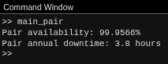
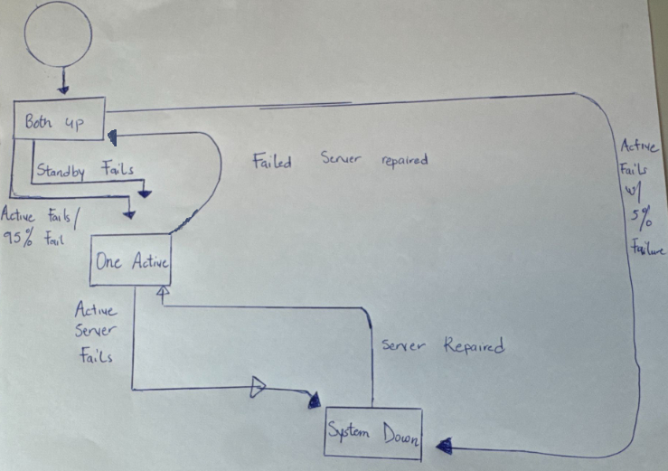

# Active-Passive Pair

We extended simulate_single.m to create simulate_pair.m, and created/ran main_pair.m. This model uses two machines, one that’s active and one that’s standby. When the active machine fails, the standby takes over with success (95%), but if failover fails (5%), the system is down until the primary repairs (and the standby can fail while active). The results showed the Pair availability at 99.96% and a Pair annual downtime of 3.8 hours.

**Command Window:**





***Figure 3: Active-Passive Pair State Diagram***

## MATLAB Code

### simulate_pair.m

```matlab title="simulate_pair.m" showLineNumbers
function [avail, outages, downtime] = simulate_pair(p_fail, repair_mean, hours)
up1 = true; up2 = true; serving = 1; downtime = 0; outages = 0; repair_left1 = 0; repair_left2 = 0;
for h = 1:hours
    if serving == 1 && up1
        if rand < p_fail
            up1 = false; repair_left1 = ceil(repair_mean * -log(rand)); outages = outages + 1;
            if up2 && rand < 0.95
                serving = 2;
            else
                serving = 0;
            end
        end
    elseif serving == 2 && up2
        if rand < p_fail
            up2 = false; repair_left2 = ceil(repair_mean * -log(rand)); outages = outages + 1;
            if up1 && rand < 0.95
                serving = 1;
            else
                serving = 0;
            end
        end
    end

    if serving == 0
        downtime = downtime + 1;
    end

    if ~up1
        repair_left1 = repair_left1 - 1;
        if repair_left1 <= 0
            up1 = true;
            if serving == 0
                serving = 1;
            end
        end
    end

    if ~up2
        repair_left2 = repair_left2 - 1;
        if repair_left2 <= 0
            up2 = true;
            if serving == 0
                serving = 2;
            end
        end
    end
end
avail = 1 - downtime / hours;
end
```

### main_pair.m

```matlab title="main_pair.m" showLineNumbers
% main_pair.m
N = 1000; hours = 8760;
avail = zeros(N,1);
for k = 1:N
    avail(k) = simulate_pair(0.001, 8, hours);
end
fprintf('Pair availability: %.4f%%\n', 100*mean(avail));
fprintf('Pair annual downtime: %.1f hours\n', 8760*(1-mean(avail)));
histogram((1-avail)*8760); xlabel('Downtime per year (hours)');
ylabel('Number of simulated years'); title('Active-Passive Pair');
```