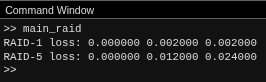
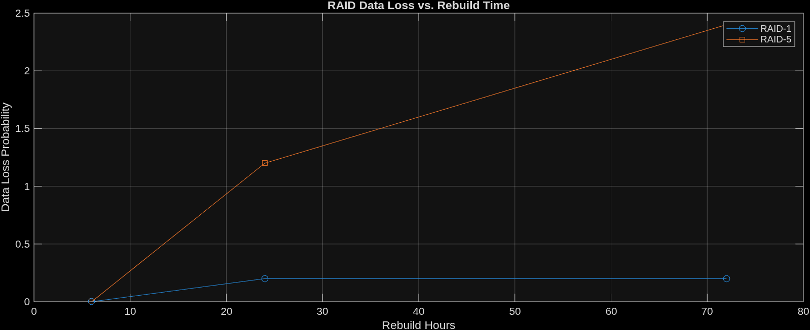

# RAID Simulation

We created simulate_raid.m, and created/ran main_raid.m, which tests 1,000+ simulated years for RAID-1 (2 disks) and RAID-5 (4 disks) with p_fail = 0.00005 per disk hour, at rebuild_hours = 6, 24, and 72 hours.

**RAID Data Loss Probability Table:**

| Rebuild Hours: | RAID-1 Loss: | RAID-5 Loss: |
|---|---|---|
| 6 | 0.000000 | 0.000000 |
| 24 | 0.002000 | 0.012000 |
| 72 | 0.002000 | 0.024000 |

**Command Window:**





***Figure 6: RAID Plot***

As seen in the RAID Plot above, at short rebuild times (6 hours), both RAID-1 and RAID-5 show 0.000000 simulated data loss probability (per the table). As the rebuild time increases, the probability of data loss increases, especially for RAID-5 (orange line). RAID-1 uses 2 disks, and RAID-5 uses 4 disks, so there is more of an opportunity for more disk failure during the rebuild window. Also, a rebuild time that is longer will keep the array vulnerable for a longer period, which increases its chances of a 2nd failure before the rebuild is complete. At 72 hours, the simulated RAID-5 data loss probability reached 0.024 vs. 0.002 for RAID-1.

## MATLAB Code

### simulate_raid.m

```matlab title="simulate_raid.m" showLineNumbers
function lost = simulate_raid(n_disks, tolerate, p_fail, rebuild_hours, hours)
% RAID-5 with 4 disks: n_disks=4, tolerate=1 (one failure survivable)
% RAID-1 mirror: n_disks=2, tolerate=1
failed = 0; rebuild_left = 0; lost = false;
for h = 1:hours
    working = n_disks - failed;
    for d = 1:working % each working disk may fail
        if rand < p_fail
            failed = failed + 1;
        end
    end
    if failed > tolerate
        lost = true; return; % second failure during rebuild window
    end
    if failed > 0
        if rebuild_left == 0
            rebuild_left = rebuild_hours; % rebuild onto spare starts
        end
        rebuild_left = rebuild_left - 1;
        if rebuild_left <= 0
            failed = 0; % rebuild complete
        end
    end
end
end
```

### main_raid.m

```matlab title="main_raid.m" showLineNumbers
% main_raid.m
N = 1000; hours = 8760;
p_fail = 0.00005; rebuild_hours = [6, 24, 72];
raid1_loss = zeros(length(rebuild_hours),1);
raid5_loss = zeros(length(rebuild_hours),1);

for i = 1:length(rebuild_hours)
    temp = zeros(N,1);
    for k = 1:N
        temp(k) = simulate_raid(2, 1, p_fail, rebuild_hours(i), hours);
    end
    raid1_loss(i) = mean(temp);
    
    temp = zeros(N,1);
    for k = 1:N
        temp(k) = simulate_raid(4, 1, p_fail, rebuild_hours(i), hours);
    end
    raid5_loss(i) = mean(temp);
end

fprintf('RAID-1 loss: %.6f %.6f %.6f\n', raid1_loss);
fprintf('RAID-5 loss: %.6f %.6f %.6f\n', raid5_loss);
plot(rebuild_hours, raid1_loss*100, 'o-'); hold on;
plot(rebuild_hours, raid5_loss*100, 's-');
xlabel('Rebuild Hours'); ylabel('Data Loss Probability');
legend('RAID-1','RAID-5'); grid on;
title('RAID Data Loss vs. Rebuild Time');
```