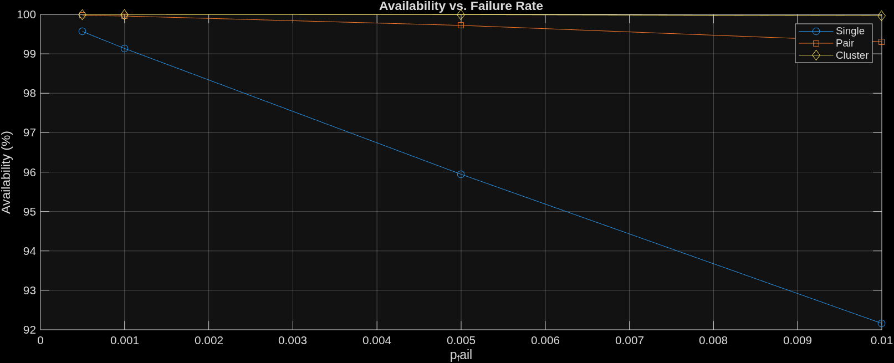

# Failure Rate Sweep

We created/ran sweep_fail.m, which tests all the architectures at p_fail = 0.0005, 0.001, 0.005, 0.01. For the test, there were 1,000 trials each.



***Figure 5.1: Failure Rate Sweep Plot***

As seen in the Failure Rate Sweep Plot above, when the Failure Rate increases, it shows a decrease in Availability as the Single Server drops the most (99.58% -> 92.14%), which is a decrease of over 7 percentage points. This decline is steep and occurs mainly because every failure directly causes downtime with no available backup. The Active-Passive Pair maintains a higher availability because of its standby redundancy, where it drops from 99.97% -> 99.31%, where the standby could cover most failures. The Three-Server Cluster, with at least one machine up, stays very close to 100% availability across all the failure rates.

## MATLAB Code

### sweep_fail.m

```matlab title="sweep_fail.m" showLineNumbers
% sweep_fail.m
N = 1000; hours = 8760;
p_fail_vals = [0.0005, 0.001, 0.005, 0.01];
single_avail = zeros(length(p_fail_vals),1);
pair_avail = zeros(length(p_fail_vals),1);
cluster_avail = zeros(length(p_fail_vals),1);

for i = 1:length(p_fail_vals)
    temp = zeros(N,1);
    for k = 1:N
        temp(k) = simulate_single(p_fail_vals(i), 8, hours);
    end
    single_avail(i) = mean(temp);

    temp = zeros(N,1);
    for k = 1:N
        temp(k) = simulate_pair(p_fail_vals(i), 8, hours);
    end
    pair_avail(i) = mean(temp);

    temp = zeros(N,1);
    for k = 1:N
        temp(k) = simulate_cluster(p_fail_vals(i), 8, hours, 1);
    end
    cluster_avail(i) = mean(temp);
end

plot(p_fail_vals, single_avail*100, 'o-'); hold on;
plot(p_fail_vals, pair_avail*100, 's-');
plot(p_fail_vals, cluster_avail*100, 'd-');
xlabel('p_fail'); ylabel('Availability (%)');
legend('Single','Pair','Cluster'); grid on;
title('Availability vs. Failure Rate');
```