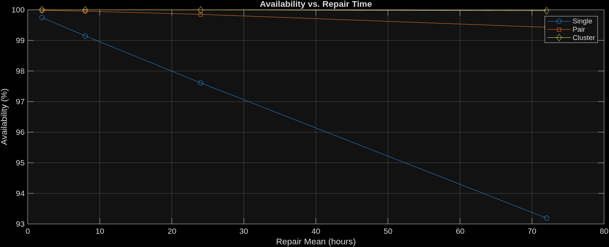

# Repair Time Sweep

We created/ran sweep_repair.m, which tests all the architectures at repair_mean = 2, 8, 24, 72 hours with fixed p_fail = 0.001.



***Figure 5.2: Repair Time Sweep Plot***

As seen in the Repair Time Sweep Plot above, as the repair time increases, the Single Server degrades the most, which drops from 99.75% -> 93.13 availability. This decrease happens as the longer repairs indicate the system will stay down longer after each failure. The Active-Passive Pair degrades slightly from 99.99% -> 99.43%, where the standby can cover most failures (whilst the primary is being repaired). For the Three-Server Cluster, at least one machine stays up near 100% across all the repair times, as there are always other machines that are available to handle the load. The Single Server degrades the most as it has no redundancy, and when it fails, the system is down for the full repair duration.

## MATLAB Code

### sweep_repair.m

```matlab title="sweep_repair.m" showLineNumbers
% sweep_repair.m
N = 1000; hours = 8760;
repair_vals = [2, 8, 24, 72];
single_avail = zeros(length(repair_vals),1);
pair_avail = zeros(length(repair_vals),1);
cluster_avail = zeros(length(repair_vals),1);

for i = 1:length(repair_vals)
    temp = zeros(N,1);
    for k = 1:N
        temp(k) = simulate_single(0.001, repair_vals(i), hours);
    end
    single_avail(i) = mean(temp);

    temp = zeros(N,1);
    for k = 1:N
        temp(k) = simulate_pair(0.001, repair_vals(i), hours);
    end
    pair_avail(i) = mean(temp);

    temp = zeros(N,1);
    for k = 1:N
        temp(k) = simulate_cluster(0.001, repair_vals(i), hours, 1);
    end
    cluster_avail(i) = mean(temp);
end

plot(repair_vals, single_avail*100, 'o-'); hold on;
plot(repair_vals, pair_avail*100, 's-');
plot(repair_vals, cluster_avail*100, 'd-');
xlabel('Repair Mean (hours)'); ylabel('Availability (%)');
legend('Single','Pair','Cluster'); grid on;
title('Availability vs. Repair Time');
```