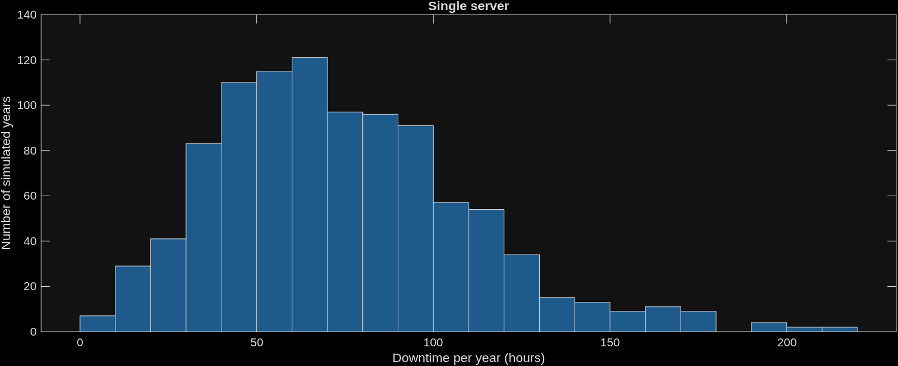
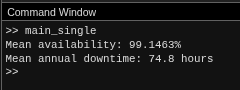

# Single Server Results

We ran main_single.m, which runs 1,000 trials with p_fail = 0.001 and 8 hour repairs.



***Figure 2: Single Server Histogram***

**Command Window:**



The results showed the Mean availability at 99.15% and a Mean annual downtime of 74.8 hours. As seen in the Single Server Histogram above, it shows the distribution of downtime per year (hours) across the 1,000 trials. We can see that the downtime itself is centered around 74.8 hours, and most of the simulated areas fall between 40 to 100 hours. This variation makes sense due to the random nature of failures and repair times. The availability of 99.15% matches the expected value of around 99.2% (in the directions), which means that the simulation worked correctly.

## MATLAB Code

### main_single.m

```matlab title="main_single.m" showLineNumbers
% main_single.m
N = 1000; hours = 8760;
avail = zeros(N,1);
for k = 1:N
    avail(k) = simulate_single(0.001, 8, hours);
end
fprintf('Mean availability: %.4f%%\n', 100*mean(avail));
fprintf('Mean annual downtime: %.1f hours\n', 8760*(1-mean(avail)));
histogram((1-avail)*8760); xlabel('Downtime per year (hours)');
ylabel('Number of simulated years'); title('Single server');
```