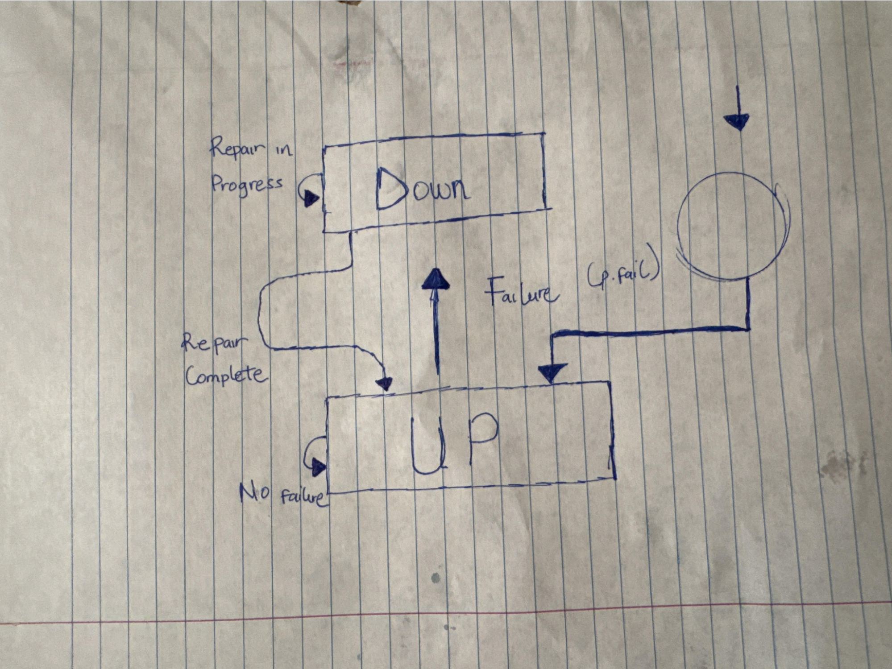

# Single Server Simulation

We created simulate_single.m, which simulates 8,760 hours. Each hour the server either works, fails with a small probability, or is under repair for a random time.



***Figure 1: Single Server State Diagram***

## MATLAB Code

### simulate_single.m

```matlab title="simulate_single.m" showLineNumbers
function [avail, outages, downtime] = simulate_single(p_fail, repair_mean, hours)
% p_fail: probability the server fails in any working hour (e.g., 0.001)
% repair_mean: average repair time in hours (e.g., 8)
up = true; downtime = 0; outages = 0; repair_left = 0;
for h = 1:hours
    if up
        if rand < p_fail
            up = false;
            outages = outages + 1;
            repair_left = ceil(repair_mean * -log(rand)); % random repair time
        end
    else
        downtime = downtime + 1;
        repair_left = repair_left - 1;
        if repair_left <= 0
            up = true;
        end
    end
end
avail = 1 - downtime / hours;
end
```