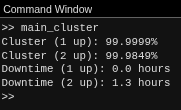
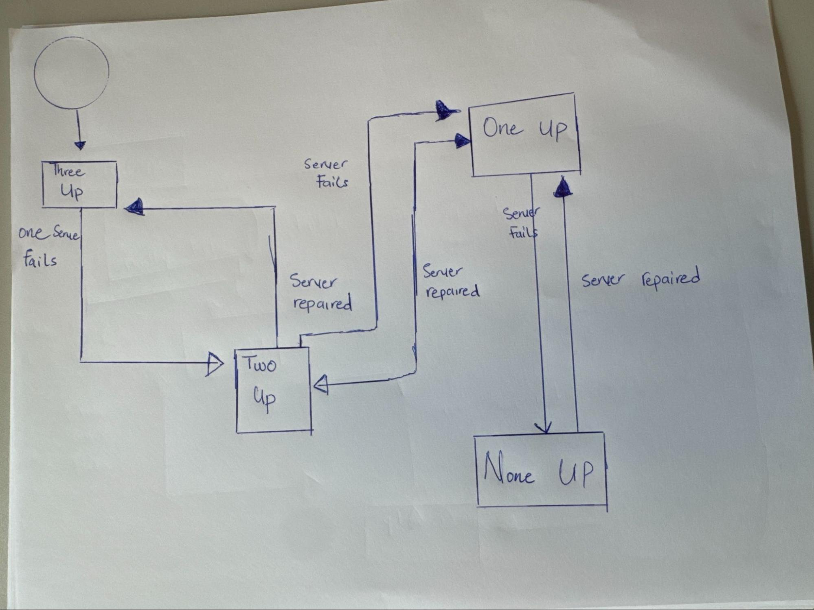

# Three-Server Cluster

We created simulate_cluster.m and created/ran main_cluster.m, which models three machines that fail and repair independently. The service is up while at least 1 machine is working. Also, we tested the second scenario where at least 2 are working. The results showed a 99.9999% availability (with 0.0 hours downtime) for at least 1 up, and 99.9849% availability (with 1.3 hours downtime) for at least 2 up.

**Command Window:**





***Figure 4: Three-Server Cluster State Diagram***

## MATLAB Code

### simulate_cluster.m

```matlab title="simulate_cluster.m" showLineNumbers
function [avail, outages, downtime] = simulate_cluster(p_fail, repair_mean, hours, min_up)
up1 = true; up2 = true; up3 = true;
downtime = 0; outages = 0;
repair_left1 = 0; repair_left2 = 0; repair_left3 = 0;
for h = 1:hours
    up_count = up1 + up2 + up3;
    if up_count < min_up
        downtime = downtime + 1;
    end

    if up1 && rand < p_fail
        up1 = false; outages = outages + 1; repair_left1 = ceil(repair_mean * -log(rand));
    end

    if up2 && rand < p_fail
        up2 = false; outages = outages + 1; repair_left2 = ceil(repair_mean * -log(rand));
    end

    if up3 && rand < p_fail
        up3 = false; outages = outages + 1; repair_left3 = ceil(repair_mean * -log(rand));
    end

    if ~up1
        repair_left1 = repair_left1 - 1;
        if repair_left1 <= 0, up1 = true; end
    end

    if ~up2
        repair_left2 = repair_left2 - 1;
        if repair_left2 <= 0, up2 = true; end
    end

    if ~up3
        repair_left3 = repair_left3 - 1;
        if repair_left3 <= 0, up3 = true; end
    end
end
avail = 1 - downtime / hours;
end
```

### main_cluster.m

```matlab title="main_cluster.m" showLineNumbers
% main_cluster.m
N = 1000; hours = 8760;
avail1 = zeros(N,1); avail2 = zeros(N,1);
for k = 1:N
    avail1(k) = simulate_cluster(0.001, 8, hours, 1);
    avail2(k) = simulate_cluster(0.001, 8, hours, 2);
end
fprintf('Cluster (1 up): %.4f%%\n', 100*mean(avail1));
fprintf('Cluster (2 up): %.4f%%\n', 100*mean(avail2));
fprintf('Downtime (1 up): %.1f hours\n', 8760*(1-mean(avail1)));
fprintf('Downtime (2 up): %.1f hours\n', 8760*(1-mean(avail2)));
figure; histogram((1-avail1)*8760); xlabel('Downtime per year (hours)');
ylabel('Number of simulated years'); title('Cluster (1 up)');
figure; histogram((1-avail2)*8760); xlabel('Downtime per year (hours)');
ylabel('Number of simulated years'); title('Cluster (2 up)');
```